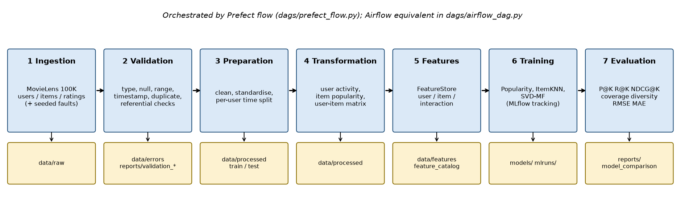

# End-to-End Data Management Pipeline for a Recommendation System

DM4ML Assignment 2. Dataset: **MovieLens 100K** (943 users, 1682 movies, 100K ratings).
Stages: Ingestion → Validation → Preparation → Transformation → Features → Training → Evaluation, orchestrated with **Prefect**.



## Setup
```bash
python3 -m venv .venv && source .venv/bin/activate
pip install -r requirements.txt
```
Python 3.10+ (tested on 3.12). Internet is needed once to download MovieLens.

## Run
```bash
python -m src.pipeline                 # all stages, plain Python
python -m src.pipeline --from-stage training   # resume from a stage
python -m dags.prefect_flow            # same stages as a Prefect flow (task dependencies)
python -m dags.prefect_flow --serve    # daily 02:00 schedule
pytest -q                              # unit tests
python -m src.serve 1                  # top-10 for user 1 using the shared FeatureStore
mlflow ui --backend-store-uri sqlite:///mlflow.db   # inspect runs
```
To see the Prefect UI: `prefect server start`, then `export PREFECT_API_URL=http://127.0.0.1:4200/api` and run the flow.
`dags/airflow_dag.py` is an equivalent Airflow DAG (not executed here).

All settings (paths, thresholds, split, model hyper-parameters, seed) live in `configs/config.yaml`.

## Layout
| Path | Purpose |
|---|---|
| `src/ingestion` | download, write raw CSVs, optional seeded fault injection |
| `src/validation` | rule checks, error datasets, validation report |
| `src/preparation` | cleaning, standardising, per-user time split |
| `src/transformation` | user activity summary, item popularity, sparse user-item matrix |
| `src/features` | `FeatureStore` (train + serve), feature catalog |
| `src/training` | Popularity, ItemKNN, SVD-MF; MLflow tracking |
| `src/evaluation` | Precision/Recall/NDCG@K, coverage, diversity, RMSE, MAE |
| `dags/` | Prefect flow and Airflow DAG |
| `reports/` | validation report, feature catalog, model comparison, architecture, screenshot, final report |
| `data/errors/` | rejected records with `error_reasons` |

## Deliverables
- Validation report: `reports/validation_report.md` (+ `data/errors/*.csv`)
- Feature catalog: `reports/feature_catalog.md`
- Model comparison: `reports/model_comparison.md`
- Successful run screenshot: `reports/screenshots/prefect_run_graph.png`
- Final report: `reports/final_report.pdf`

## Key design decisions
- **Fault injection.** MovieLens is already clean, so a seeded set of faults (nulls, duplicates, invalid ratings/timestamps, orphan keys, bad age type) is added to the raw copy. Disable with `ingestion.inject_faults: false`.
- **Per-user chronological split.** Each user's latest 20% of ratings are the test set. A single global cut-off left only 98 evaluable users because most users rate in one short session.
- **No leakage.** Derived datasets, features and models use the train split only.
- **Relevance** = test rating ≥ 4; already-seen items are excluded from recommendations.
