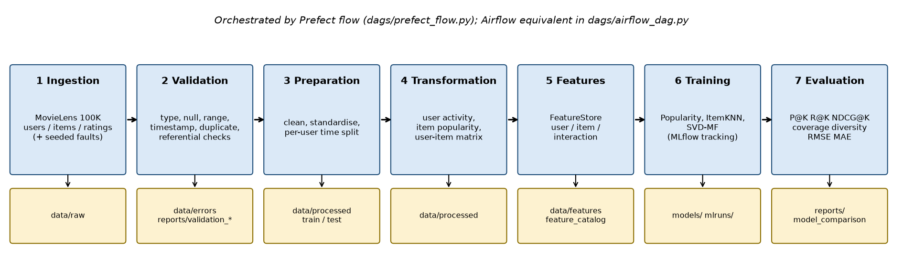

# End-to-End Data Management Pipeline for a Recommendation System

DM4ML Assignment 2

## 1. Overview and tools
The pipeline recommends movies using MovieLens 100K (943 users, 1,682 items, ~100K ratings with timestamps; users have age/gender/occupation, items have release date and 19 genre flags). It runs seven stages: ingestion, validation, preparation, transformation, feature management, training and evaluation. Tools: Python, pandas/pyarrow (Parquet storage), scipy and scikit-learn (models), MLflow (tracking, SQLite backend), Prefect (orchestration), pytest. Validation and the feature layer are custom code so every rule and feature definition is visible and testable.

## 2. Design decisions
**Ingestion and validation.** Raw users, items and interactions are written to CSV. Because MovieLens is clean, a documented, seeded set of faults is injected into the raw copy: 40 null ratings, 60 duplicate rows, 30 out-of-range ratings, 25 bad timestamps, 20 orphan user ids, 20 orphan item ids and 10 non-numeric ages. Validation checks nulls, types, rating range (1-5), timestamp range, duplicates and referential integrity. All injected faults were detected: 194 interaction rows were quarantined to `data/errors/interactions_errors.csv` with the violated rules. Users whose only fault was a bad age (10) were repaired (age blanked and later median-imputed) instead of dropped, since dropping them would have orphaned their ratings; they are still logged.

**Preparation and transformation.** Types and formats are standardised, residual missing values imputed (one item has no release date), and duplicate user-item pairs reduced to the latest rating. The split is per-user chronological (latest 20% of each user's ratings to test; users with fewer than 5 ratings stay in train): 80,262 train and 19,604 test rows. A global time cut-off was tried first and left only 98 users evaluable, so it was rejected. Derived datasets built on train only: user activity summary, item popularity, and a 943 x 1,682 sparse rating matrix (density about 5%).

**Feature management.** A `FeatureStore` class computes user, item and interaction features from train data as of the end of the training window, and exposes `get_user_features`, `get_item_features` and `get_interaction_features`. Training, evaluation and the serving example (`src/serve.py`) all call it, so definitions are shared offline and online. The 17 features are listed in `feature_catalog.md` (e.g. user average rating, activity count, preferred genre, days since last interaction, item popularity and average rating, user-genre affinity).

**Models.** (1) Popularity baseline (most positive ratings). (2) Item-based collaborative filtering (cosine similarity on positive feedback, 50 neighbours). (3) SVD matrix factorisation with damped user/item biases and 30 latent factors, ranked by predicted rating over items with at least 20 ratings. Parameters, model files and the feature catalog are logged per run in MLflow; evaluation metrics are logged to the same runs.

**Orchestration.** A Prefect flow chains the seven tasks with explicit `wait_for` dependencies, one retry on ingestion, and an optional daily cron. The equivalent Airflow DAG is included. The seed is fixed in the config, so reruns give the same results.

## 3. Results (K = 10, 905 evaluated users)
| Model | P@10 | R@10 | NDCG@10 | Coverage | Diversity | RMSE | MAE |
|---|---|---|---|---|---|---|---|
| Popularity | 0.0768 | 0.0743 | 0.0992 | 0.0465 | 0.6941 | 1.0703 | 0.8571 |
| Item-KNN | 0.1207 | 0.1398 | 0.1697 | 0.2784 | 0.7006 | n/a | n/a |
| SVD-MF | 0.0575 | 0.0516 | 0.0707 | 0.1209 | 0.7581 | 0.9876 | 0.7841 |

Item-KNN is the best ranker: it improves NDCG@10 over popularity by 71% and raises catalogue coverage from 4.7% to 27.8%. SVD-MF is the best rating predictor (RMSE 0.988 vs 1.070) and the most diverse, but ranking by predicted rating is a weak top-N strategy, so its ranking metrics fall below popularity. Item-KNN does not predict ratings, so its RMSE/MAE are not reported.

## 4. Limitations
- Results come from a single split on one small dataset, with no confidence intervals or hyper-parameter search.
- Fault injection is synthetic; real-world faults may be subtler.
- Features use one global as-of time (end of the latest train rating). Under the per-user split, some users' test events occur before other users' train events, so there is mild temporal leakage across users that a strict global split would avoid.
- Cold-start users and items are not handled beyond popularity fallbacks.
- Diversity uses genre vectors only; no novelty or fairness measures.
- Features are recomputed from parquet at load time; there is no online store or point-in-time join service (Feast would provide these).
